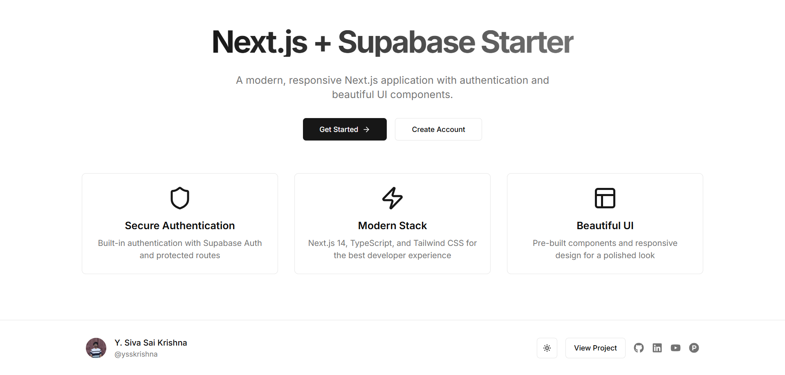
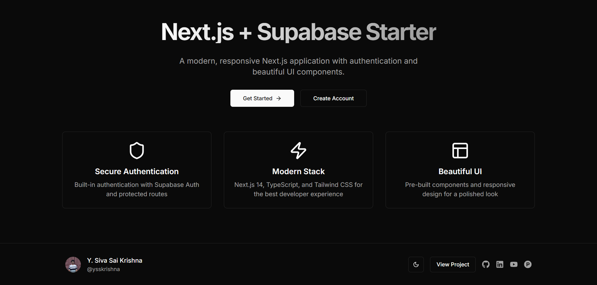
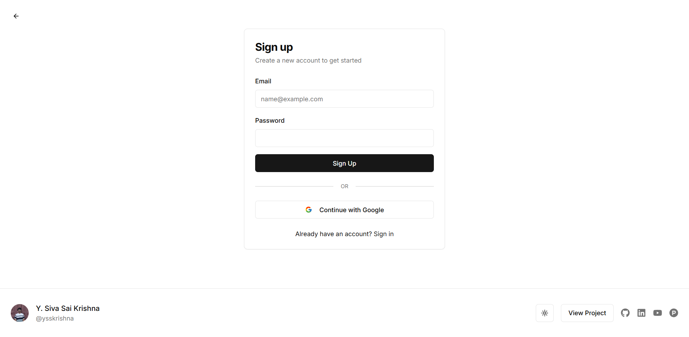
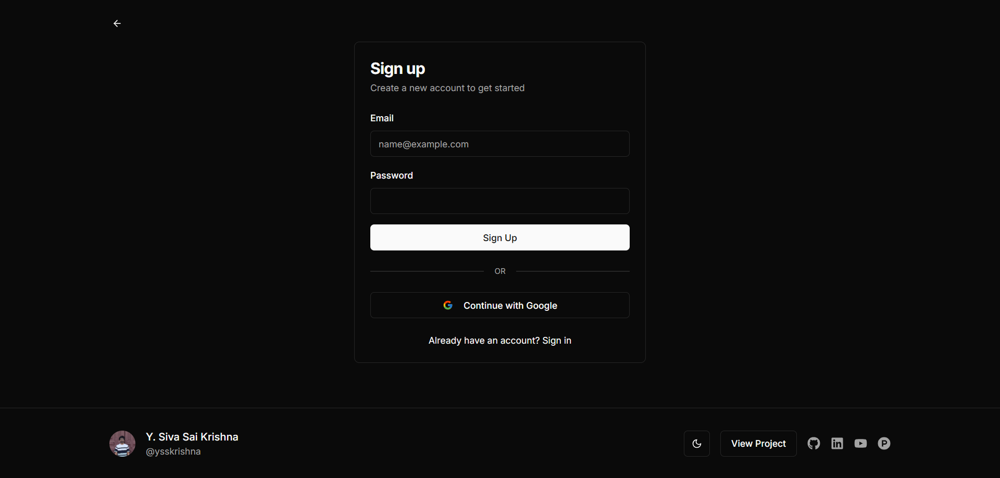
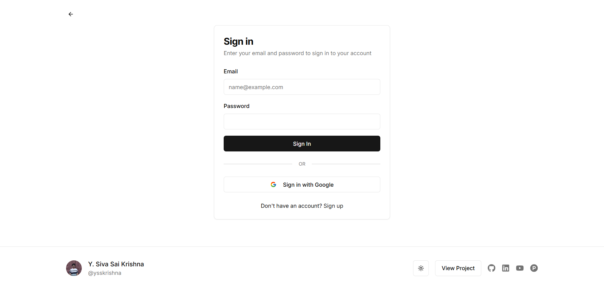
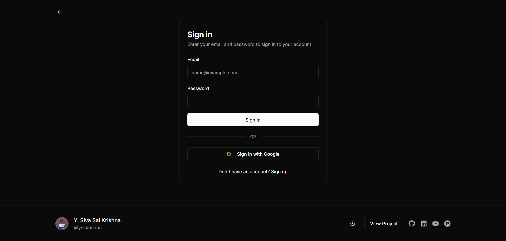
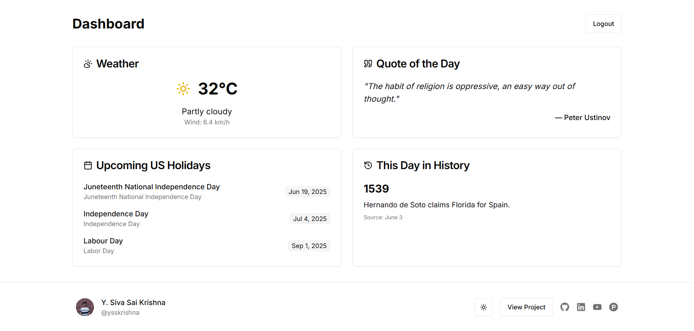
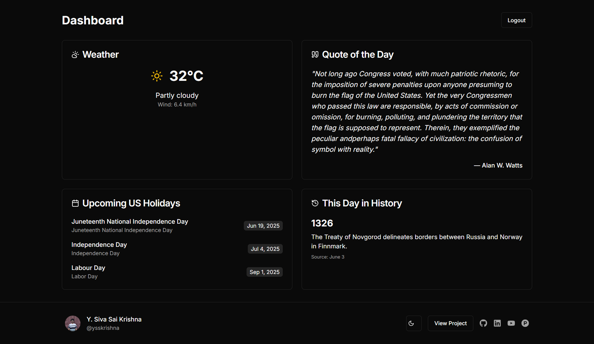

# NextJS Supabase Starter

[](https://nextjs.org/)
[](https://reactjs.org/)
[](https://www.typescriptlang.org/)
[](https://supabase.com/)
[](https://tailwindcss.com/)
[](https://www.radix-ui.com/)
[](https://opensource.org/licenses/MIT)
[](https://ysskrishna.space)

A modern Next.js starter template with Supabase integration, featuring a beautiful UI powered by Radix UI components and Tailwind CSS.

## Demo

- **URL:** [https://ysskrishna-nextjs-supabase-starter.vercel.app/](https://ysskrishna-nextjs-supabase-starter.vercel.app/)
- **Email:** `demo@gmail.com`
- **Password:** `demopassword`

## Features

- 🔐 Authentication system with Supabase
- 📱 Responsive design with Tailwind CSS
- 🎨 Modern UI components from Radix UI
- 📊 Dashboard interface
- 🎯 TypeScript support
- 🌓 Light/Dark theme support with system preference detection
- 🔄 Automatic route protection and redirections

## Authentication Flow

The application implements a complete authentication flow with the following features:

- Protected routes with automatic redirections
- Session management using Supabase Auth
- Google OAuth integration
- Persistent authentication state
- Secure token handling

For detailed setup instructions, please refer to the [Authentication Guide](./docs/AUTHENTICATION.md) which includes:
- Supabase project setup
- Google OAuth configuration
- Environment variables setup
- Authentication middleware configuration


## Screenshots

### Landing Page
<div style="display: flex; gap: 1rem; margin-bottom: 1rem;">
  <div>
    <h4>Light Theme</h4>
    
  </div>
  <div>
    <h4>Dark Theme</h4>
    
  </div>
</div>

### SignUp Page
<div style="display: flex; gap: 1rem; margin-bottom: 1rem;">
  <div>
    <h4>Light Theme</h4>
    
  </div>
  <div>
    <h4>Dark Theme</h4>
    
  </div>
</div>

### SignIn Page
<div style="display: flex; gap: 1rem; margin-bottom: 1rem;">
  <div>
    <h4>Light Theme</h4>
    
  </div>
  <div>
    <h4>Dark Theme</h4>
    
  </div>
</div>

### Dashboard Page
<div style="display: flex; gap: 1rem; margin-bottom: 1rem;">
  <div>
    <h4>Light Theme</h4>
    
  </div>
  <div>
    <h4>Dark Theme</h4>
    
  </div>
</div>

## Tech Stack

- **Framework:** Next.js 15
- **Database & Auth:** Supabase
- **Styling:** Tailwind CSS
- **UI Components:** Radix UI
- **Form Handling:** React Hook Form
- **Validation:** Zod
- **Charts:** Recharts
- **Icons:** Lucide React
- **Date Handling:** date-fns

## Getting Started

1. Clone the repository
2. Install dependencies:
   ```bash
   npm install
   # or
   pnpm install
   ```
3. Set up your Supabase project and add the environment variables
4. Run the development server:
   ```bash
   npm run dev
   # or
   pnpm dev
   ```

## Available Scripts

- `npm run dev` - Start development server
- `npm run build` - Build for production
- `npm run start` - Start production server
- `npm run lint` - Run ESLint

## Project Structure

```
├── app/              # Next.js app directory
│   ├── auth/        # Authentication routes
│   ├── dashboard/   # Dashboard pages
│   ├── signin/      # Sign in page
│   └── signup/      # Sign up page
├── components/      # Reusable UI components
├── lib/            # Utility functions and configurations
├── public/         # Static assets
└── styles/         # Global styles
└── docs/           # Documentation
    └── AUTHENTICATION.md  # Authentication setup guide
```

## Dependencies

The project uses a comprehensive set of modern dependencies including:

- Radix UI components for accessible UI elements
- React Hook Form for form handling
- Zod for schema validation

## Contributing

Contributions are welcome! Please feel free to submit a Pull Request.

## Built and maintained by

NextJS Supabase Starter is built and maintained by:

| | Name | GitHub | Role |
|---|------|--------|------|
|  | **Y. Siva Sai Krishna** | [@ysskrishna](https://github.com/ysskrishna) | Creator |

## Support

If you find this project helpful:

- ⭐ Star the repository
- 🐛 [Report issues](https://github.com/ysskrishna/nextjs-supabase-starter/issues)
- 🔀 Submit pull requests
- 💝 [Sponsor on GitHub](https://github.com/sponsors/ysskrishna)

## License

MIT © [Y. Siva Sai Krishna](https://github.com/ysskrishna) — see [LICENSE](LICENSE) for details.

---

<p align="left">
  <a href="https://github.com/ysskrishna">Author's GitHub</a> •
  <a href="https://linkedin.com/in/ysskrishna">Author's LinkedIn</a> •
  <a href="https://ysskrishna.space">Author's site</a> •
  <a href="https://github.com/ysskrishna/nextjs-supabase-starter/issues">Report Issues</a>
</p>
